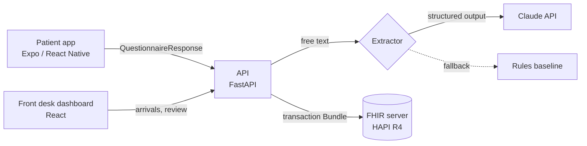

# Clinic Intake Assistant

Patients answer a check-in form on their phone in their own words. An LLM turns
those answers into coded FHIR R4 records (allergies, medications, conditions),
and the front desk reviews every AI-extracted item before it counts.

> **Synthetic data only.** Every patient in this repo is made up, and every
> resource the app writes carries a `demo` tag. Never enter real patient
> information, and never point it at HAPI's public test server with anything
> but made-up data: that server is shared and public.

## Why this exists

Clinics still retype paper intake forms into the EHR. Patients write
"Lipitor at night" or "penicillin gives me hives", and someone has to turn that
into RxNorm and SNOMED codes. This project automates the first pass and keeps a
person in the loop for the decision.

## What it demonstrates

- **Integration with a real healthcare standard.** The form is a FHIR
  `Questionnaire`, answers arrive as a `QuestionnaireResponse`, and the result
  is written to a FHIR server as one atomic transaction `Bundle`: `Patient`,
  `Encounter`, `AllergyIntolerance`, `MedicationStatement`, `Condition`,
  `Observation` and `Provenance`.
- **LLM output you can trust enough to review.**
  - Structured outputs with a JSON schema whose terminology fields are enums,
    so the model can only pick concepts the clinic has approved. Codes are then
    attached from a local table, never generated by the model.
  - Every extracted item must quote the patient's words. The server checks the
    quote really appears in the answer and flags it in the dashboard if not.
  - Anything outside the allowlist stays uncoded ("Not coded") instead of being
    forced into a wrong code.
- **Human in the loop.** Every AI item carries a review extension, and
  allergies and conditions start as `unconfirmed`. Staff approve or reject each
  one: approval confirms it, rejection marks it `entered-in-error`, and either
  way a second `Provenance` records who verified it.
- **Graceful degradation.** If the model call fails, refuses or is cut off, the
  intake still goes through with a deterministic rules extractor, and the
  dashboard shows which extractor produced each item.
- **Evals, not vibes.** 12 hand-labelled synthetic cases cover brand names, lay
  terms, misspellings, family history, stopped medicines, intolerances that are
  not allergies and uncoded items. The rules extractor is the baseline to beat.
- **A form you can change without shipping an app.** The mobile app renders
  whatever `Questionnaire` the server returns, including FHIR min/max
  extensions for the pain scale.

## Architecture



| Folder | What it is |
| --- | --- |
| `server/` | FastAPI app: questionnaire, intake, extraction, FHIR writes, review workflow, evals and tests |
| `dashboard/` | React front desk view: today's arrivals, per-item approve or reject, raw FHIR resources |
| `mobile/` | Expo patient check-in app that renders the FHIR Questionnaire |

## Run it

### Everything with Docker

```bash
docker compose up --build
```

- Dashboard: http://localhost:5173
- API: http://localhost:8000/api/health
- FHIR server: http://localhost:8080/fhir

HAPI takes a minute to start. Use **+ Add demo patient** on the dashboard to
see a full intake without the phone.

### Locally, for development

```bash
# API (Python 3.13)
cd server
python -m venv .venv && source .venv/bin/activate
pip install -r requirements-dev.txt
cp .env.example .env          # FHIR_BASE_URL=memory needs no FHIR server
uvicorn app.main:app --reload

# Dashboard
cd dashboard && npm ci && npm run dev    # http://localhost:5173, proxies /api to :8000

# Patient app
cd mobile && npm ci
cp .env.example .env          # set EXPO_PUBLIC_API_URL to your computer's Wi-Fi address
npx expo start                # scan the QR code with Expo Go
```

### Turning on Claude

Without a key, the API uses the offline rules extractor. To use Claude, set
`ANTHROPIC_API_KEY` in `server/.env` (git ignores it) or in your shell before
`docker compose up`. The model and effort level are `CLAUDE_MODEL` and
`CLAUDE_EFFORT`. Keep keys out of commits, issues and screenshots.

## Evals

```bash
cd server
python -m evals.run                       # rules baseline, offline
python -m evals.run --extractor claude    # needs ANTHROPIC_API_KEY, costs a few cents
python -m evals.run --extractor claude --save
```

Medications are scored on concept and status, so calling a stopped medicine
active counts as a miss.

| Extractor | Conditions F1 | Allergies F1 | Medications F1 | No-known-allergies | Quotes found |
| --- | --- | --- | --- | --- | --- |
| Rules baseline | 0.84 | 0.89 | 0.91 | 12/12 | 38/38 |
| Claude | run it and add your numbers here | | | | |

The baseline misses what you'd expect from keyword rules: lay terms ("sugar
diabetes"), misspellings ("asthema", "singular"), and symptoms mistaken for
diagnoses.

## Tests

```bash
cd server && pytest                       # 19 tests, every resource validated against FHIR R4B models
cd dashboard && npm run build
cd mobile && npm run typecheck
```

## A two-minute demo

1. Open the dashboard and the patient app side by side.
2. On the phone, check in as a made-up patient. Write medicines by brand name
   and mention something the patient stopped taking.
3. The arrival appears on the dashboard within seconds, with each allergy,
   medicine and condition coded and quoted back from the patient's own words.
4. Reject one item, approve the rest, then open **View FHIR resources** to show
   the confirmed records and the two `Provenance` entries.
5. Show the eval table and explain why codes come from an allowlist rather than
   from the model.

## Limits and next steps

- The terminology table is a small demo allowlist. Check codes against a
  terminology server (`$validate-code`) before any real use.
- No authentication. A real deployment would use SMART on FHIR and run against
  an EHR sandbox.
- Patient matching is name plus birth date, which is fine for a demo and not
  for production.
- Handling real patient data would need a signed BAA with every vendor in the
  path, audit logging and a security review.
