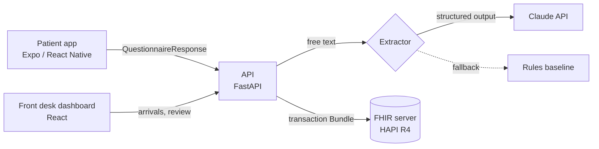

# Clinic Intake Assistant

Patients answer a check-in form on their phone in their own words. An LLM turns
those answers into coded FHIR R4 records (allergies, medications, conditions),
and the front desk reviews every AI-extracted item before it counts.

> **Synthetic data only.** Every patient in this project is made up, and every
> record the app writes carries a `demo` tag. It is a portfolio project, not a
> medical device, and it has never handled real patient information.

## The problem

Clinics still retype intake forms into the EHR. Patients write "Lipitor at
night" or "penicillin gives me hives", and someone has to turn that into RxNorm
and SNOMED codes by hand. It is slow, easy to get wrong, and the mistakes that
matter most (a missed allergy, a medicine the patient already stopped) are the
easiest to miss.

This project automates the first pass and keeps a person in the loop for the
decision.

## How it works

1. **The patient checks in on their phone.** The app renders the clinic's
   intake form, which is a FHIR `Questionnaire` served by the backend, so the
   clinic can change its questions without shipping a new app. Answers go back
   as a `QuestionnaireResponse`.
2. **The backend extracts structured data.** Claude reads the free-text answers
   and returns allergies, medications and conditions as structured output. A
   deterministic rules extractor takes over if the model call fails, refuses or
   is cut off, so check-in never breaks.
3. **Everything is written to a FHIR server in one transaction.** `Patient`,
   `Encounter`, `QuestionnaireResponse`, `AllergyIntolerance`,
   `MedicationStatement`, `Condition`, `Observation` and `Provenance` go in as a
   single atomic `Bundle`. Returning patients are matched instead of
   duplicated.
4. **The front desk reviews.** The dashboard lists today's arrivals. Each
   extracted item shows its code, the patient's own words it came from, and
   Approve or Reject buttons.

## Design choices

- **The model picks concepts, it never writes codes.** The structured-output
  schema limits each allergy, medication and condition to an approved list of
  concepts. SNOMED, RxNorm and LOINC codes are then attached from a local table.
  Anything outside the list is kept as "Not coded" rather than forced into the
  wrong code.
- **Every item has to show its evidence.** The model must quote the patient's
  words for each item. The server checks the quote really appears in the answer
  and the dashboard flags any that don't.
- **Nothing counts until a person approves it.** AI items carry a review status,
  and allergies and conditions start as `unconfirmed`. Approval confirms an
  item, rejection marks it `entered-in-error`, and a second `Provenance` records
  who verified it.
- **Context the model must get right.** Family history is not the patient's
  history, a medicine the patient stopped stays stopped, a side effect the
  patient says isn't an allergy isn't recorded as one, and today's symptoms are
  not recorded as diagnoses.

## Evaluation

Twelve hand-labelled synthetic cases cover brand names, lay terms ("sugar
diabetes"), misspellings, family history, stopped medicines, intolerances that
are not allergies, uncoded items and blank answers. Medications are scored on
both the concept and its status, so calling a stopped medicine active counts as
a miss.

| Extractor | Conditions F1 | Allergies F1 | Medications F1 | No-known-allergies | Quotes found |
| --- | --- | --- | --- | --- | --- |
| Rules baseline | 0.84 | 0.89 | 0.91 | 12/12 | 38/38 |

The rules baseline misses what keyword matching always misses: lay terms,
misspellings and symptoms mistaken for diagnoses. It is the bar the Claude
extractor is measured against on the same cases, and those results will be
added here.

## Stack

| Part | Built with |
| --- | --- |
| Patient app | Expo (React Native), TypeScript |
| Front desk dashboard | React, Vite, TypeScript |
| Backend | Python, FastAPI, Pydantic, Anthropic SDK |
| Health records | FHIR R4 on a HAPI FHIR server |
| Quality | pytest with FHIR model validation, the eval set above, GitHub Actions CI |

## Limits and next steps

- The terminology table is a small demo list. Real use would check every code
  against a terminology server.
- There is no authentication yet. A real deployment would use SMART on FHIR and
  run against an EHR sandbox.
- Patient matching uses name and birth date, which is enough for a demo but not
  for production.
- Handling real patient data would need agreements with every vendor in the
  path, audit logging and a security review.
